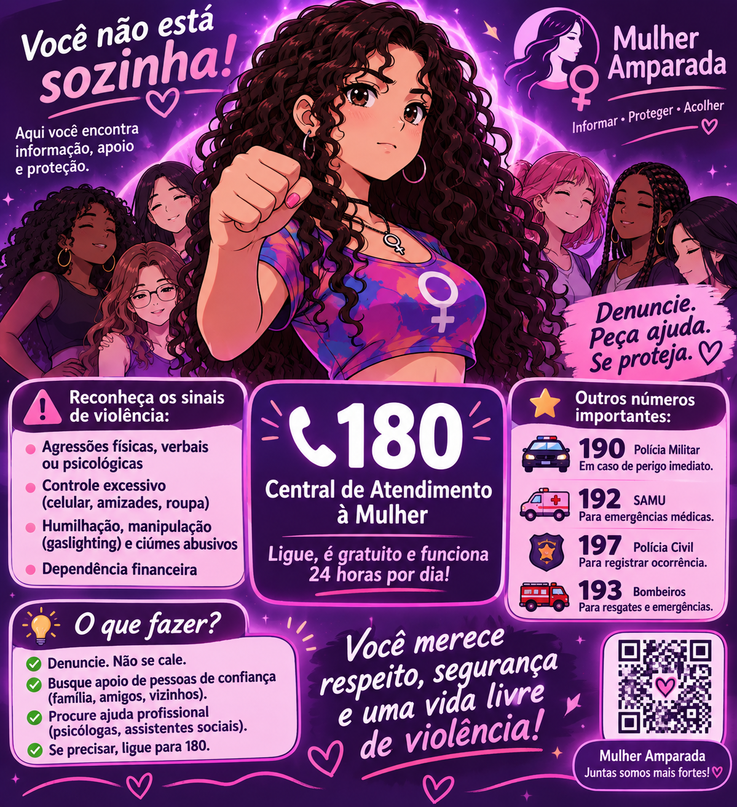
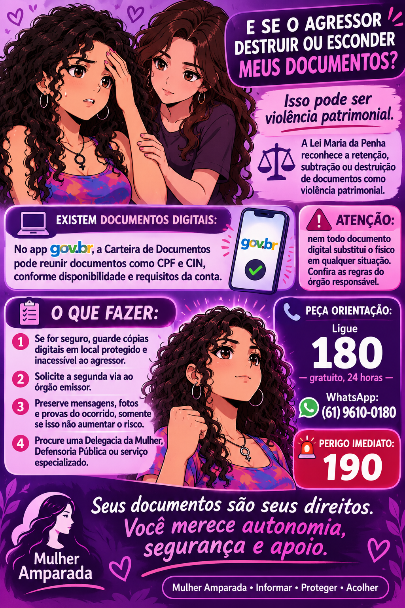
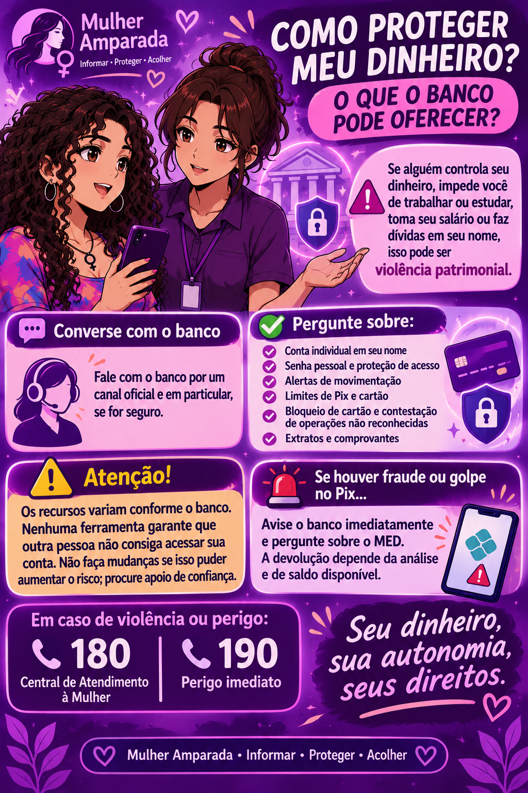

## 🌷 Mini-cursos visuais:

O **Mulher Amparada** também oferece mini-cursos ilustrados com o objetivo de tornar informações importantes sobre segurança, direitos e autonomia feminina mais acessíveis.

Por meio de ilustrações e explicações visuais, os conteúdos abordam situações que podem fazer parte da realidade de mulheres em situação de vulnerabilidade.

### 📚 Conteúdos disponíveis:

#### 1. 📞 Telefones e canais de emergência:

Conheça os principais canais de atendimento e saiba onde buscar orientação e ajuda em situações de violência.

#### 2. 📄 Proteção e recuperação de documentos:

Entenda como preservar documentos importantes, conhecer alternativas digitais e buscar formas de recuperar informações caso documentos sejam destruídos ou apagados por um agressor.

#### 3. 💰 Proteção financeira:

Conheça recursos oferecidos pelos bancos, alternativas para proteger seu dinheiro e possibilidades de fortalecer sua autonomia financeira.

### 🎯 Objetivo:

- Facilitar o acesso à informação.
- Incentivar a autonomia financeira.
- Apresentar recursos de proteção.
- Divulgar canais de atendimento e orientação.
- Transformar assuntos complexos em conteúdos visuais acessíveis.

> Informação acessível também é uma forma de proteção. Conhecer seus direitos e possibilidades pode ajudar a construir caminhos para uma vida com mais autonomia e segurança.

### 🔗Link:

https://github.com/mulher-amparada/mulher-amparada-app/tree/main/Mini%20cursos%20com%20imagens

---

**Mulher Amparada — tecnologia, informação, proteção e autonomia.**