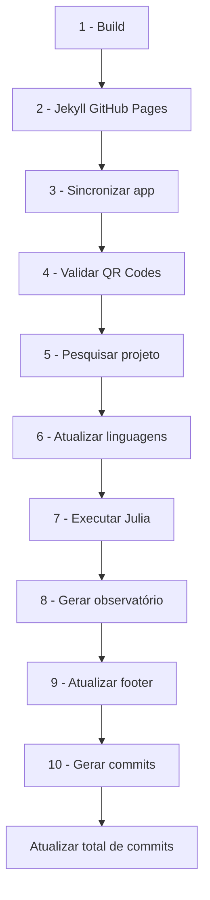

# Documentação do workflow — Mulher Amparada

- **Arquivo de origem:** `.github/workflows/automations.yml`
- **Arquivo gerado:** `pesquisas/workflow.md`
- **Jobs identificados:** 11
- **Etapas identificadas:** 2

## Tabela completa de jobs e etapas

| ID do job | Nome | Runner | Dependências | Etapas |
|---|---|---|---|---|
| `build` | 1 - Build | Não identificado | Nenhuma | Nenhuma identificada |
| `jekyll` | 2 - Jekyll GitHub Pages | Não identificado | `build` | Nenhuma identificada |
| `sincronizar_app` | 3 - Sincronizar app | Não identificado | `jekyll` | Nenhuma identificada |
| `validar_qrs` | 4 - Validar QR Codes | Não identificado | `sincronizar_app` | Nenhuma identificada |
| `pesquisar_projeto` | 5 - Pesquisar projeto | Não identificado | `validar_qrs` | Nenhuma identificada |
| `linguagens` | 6 - Atualizar linguagens | Não identificado | `pesquisar_projeto` | Nenhuma identificada |
| `main_julia` | 7 - Executar Julia | Não identificado | `linguagens` | Nenhuma identificada |
| `observatorio` | 8 - Gerar observatório | Não identificado | `main_julia` | Nenhuma identificada |
| `atualizar_footer` | 9 - Atualizar footer | Não identificado | `observatorio` | Nenhuma identificada |
| `gerar_commits` | 10 - Gerar commits | Não identificado | `atualizar_footer` | Nenhuma identificada |
| `atualizar-total-commits` | Atualizar total de commits | ubuntu-26.04 | `gerar_commits` | 1. Baixar histórico completo (`actions/checkout@v7`); 2. Atualizar total de commits — executa comandos |

## Grafo completo de dependências

As setas representam as dependências declaradas em `needs` no YAML original.



## Detalhamento dos jobs

### 1 - Build

- **ID:** `build`
- **Runner:** `Não identificado`
- **Dependências:** Nenhuma

| # | Etapa | Ação | Execução |
|---:|---|---|---|
| — | Nenhuma etapa identificada | — | — |

### 2 - Jekyll GitHub Pages

- **ID:** `jekyll`
- **Runner:** `Não identificado`
- **Dependências:** `build`

| # | Etapa | Ação | Execução |
|---:|---|---|---|
| — | Nenhuma etapa identificada | — | — |

### 3 - Sincronizar app

- **ID:** `sincronizar_app`
- **Runner:** `Não identificado`
- **Dependências:** `jekyll`

| # | Etapa | Ação | Execução |
|---:|---|---|---|
| — | Nenhuma etapa identificada | — | — |

### 4 - Validar QR Codes

- **ID:** `validar_qrs`
- **Runner:** `Não identificado`
- **Dependências:** `sincronizar_app`

| # | Etapa | Ação | Execução |
|---:|---|---|---|
| — | Nenhuma etapa identificada | — | — |

### 5 - Pesquisar projeto

- **ID:** `pesquisar_projeto`
- **Runner:** `Não identificado`
- **Dependências:** `validar_qrs`

| # | Etapa | Ação | Execução |
|---:|---|---|---|
| — | Nenhuma etapa identificada | — | — |

### 6 - Atualizar linguagens

- **ID:** `linguagens`
- **Runner:** `Não identificado`
- **Dependências:** `pesquisar_projeto`

| # | Etapa | Ação | Execução |
|---:|---|---|---|
| — | Nenhuma etapa identificada | — | — |

### 7 - Executar Julia

- **ID:** `main_julia`
- **Runner:** `Não identificado`
- **Dependências:** `linguagens`

| # | Etapa | Ação | Execução |
|---:|---|---|---|
| — | Nenhuma etapa identificada | — | — |

### 8 - Gerar observatório

- **ID:** `observatorio`
- **Runner:** `Não identificado`
- **Dependências:** `main_julia`

| # | Etapa | Ação | Execução |
|---:|---|---|---|
| — | Nenhuma etapa identificada | — | — |

### 9 - Atualizar footer

- **ID:** `atualizar_footer`
- **Runner:** `Não identificado`
- **Dependências:** `observatorio`

| # | Etapa | Ação | Execução |
|---:|---|---|---|
| — | Nenhuma etapa identificada | — | — |

### 10 - Gerar commits

- **ID:** `gerar_commits`
- **Runner:** `Não identificado`
- **Dependências:** `atualizar_footer`

| # | Etapa | Ação | Execução |
|---:|---|---|---|
| — | Nenhuma etapa identificada | — | — |

### Atualizar total de commits

- **ID:** `atualizar-total-commits`
- **Runner:** `ubuntu-26.04`
- **Dependências:** `gerar_commits`

| # | Etapa | Ação | Execução |
|---:|---|---|---|
| 1 | Baixar histórico completo | `actions/checkout@v7` | — |
| 2 | Atualizar total de commits | — | \| |

## YAML original completo

O bloco abaixo reproduz o conteúdo original do arquivo `automations.yml`, preservando comandos, condições, variáveis, comentários e configurações.

````yaml
name: ⚙️Executar todos os workflows

on:
  workflow_dispatch:
  workflow_call:

permissions:
  contents: write
  actions: write
  pages: write
  id-token: write

jobs:
  build:
    name: "1 - Build"
    uses: ./.github/workflows/build.yml
    secrets: inherit
    permissions:
      contents: write

  jekyll:
    name: "2 - Jekyll GitHub Pages"
    needs: build
    uses: ./.github/workflows/jekyll-gh-pages.yml
    permissions:
      contents: read
      pages: write
      id-token: write

  sincronizar_app:
    name: "3 - Sincronizar app"
    needs: jekyll
    uses: ./.github/workflows/sincronizar-app.yml
    permissions:
      contents: write

  validar_qrs:
    name: "4 - Validar QR Codes"
    needs: sincronizar_app
    uses: ./.github/workflows/validar-qrs.yml
    permissions:
      contents: write

  pesquisar_projeto:
    name: "5 - Pesquisar projeto"
    needs: validar_qrs
    uses: ./.github/workflows/pesquisar-projeto.yml
    permissions:
      contents: write

  linguagens:
    name: "6 - Atualizar linguagens"
    needs: pesquisar_projeto
    uses: ./.github/workflows/linguagens.yml
    permissions:
      contents: write

  main_julia:
    name: "7 - Executar Julia"
    needs: linguagens
    uses: ./.github/workflows/main-julia.yml
    permissions:
      contents: read

  observatorio:
    name: "8 - Gerar observatório"
    needs: main_julia
    uses: ./.github/workflows/observatorio.yml
    permissions:
      contents: write

  atualizar_footer:
    name: "9 - Atualizar footer"
    needs: observatorio
    uses: ./.github/workflows/atualizar-footer.yml
    permissions:
      contents: write

  gerar_commits:
    name: "10 - Gerar commits"
    needs: atualizar_footer
    uses: ./.github/workflows/gerar-commits.yml
    permissions:
      contents: write

  atualizar-total-commits:
    name: Atualizar total de commits
    needs: gerar_commits
    runs-on: ubuntu-26.04

    permissions:
      contents: write

    steps:
      - name: Baixar histórico completo
        uses: actions/checkout@v7
        with:
          fetch-depth: 0
          ref: main

      - name: Atualizar total de commits
        shell: bash
        run: |
          set -euo pipefail

          ARQUIVO="README.md"
          BASE=6385

          if [ ! -f "$ARQUIVO" ]; then
            echo "Erro: README.md não encontrado."
            exit 1
          fi

          TOTAL_ATUAL=$(git rev-list --count HEAD)
          TOTAL=$((BASE + TOTAL_ATUAL))

          export TOTAL

          python3 - <<'PY'
          import os
          import re
          from pathlib import Path

          arquivo = Path("README.md")
          conteudo = arquivo.read_text(encoding="utf-8")

          padrao = r"(?m)^(\*\*Commits totais de toda a história do projeto\s*=\s*)\d+(\*\*)$"

          atualizado, quantidade = re.subn(
              padrao,
              lambda m: f"{m.group(1)}{os.environ['TOTAL']}{m.group(2)}",
              conteudo,
          )

          if quantidade == 0:
              raise SystemExit(
                  "Erro: a linha de total de commits não foi encontrada no README.md."
              )

          arquivo.write_text(atualizado, encoding="utf-8")
          PY

          git add "$ARQUIVO"

          if git diff --cached --quiet; then
            echo "O total de commits já está atualizado."
            exit 0
          fi

          git config user.name "github-actions[bot]"
          git config user.email "41898282+github-actions[bot]@users.noreply.github.com"

          git commit -m "docs: atualizar total de commits"

          git fetch origin main
          git rebase origin/main

          git push origin HEAD:main
````
